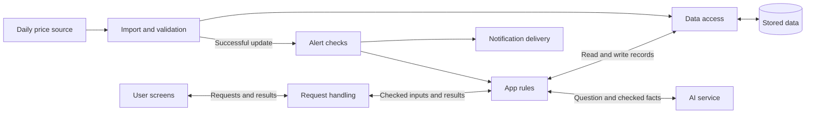

# Architecture Options

Status: Spring Boot is chosen. J01–J04 uses one local app and an H2 file database. Its implemented records and interfaces are documented in the [implementation guide](implementation-baseline-j01-j04.md). The wider architecture below includes proposals for later jobs.

The [project scope](project-scope.md) defines feature decisions. This document explains the wider target architecture. Use the implementation guide for current Java names, web routes, and storage rules; do not treat proposed history, alert, AI, sharing, or offline interfaces as completed code.

## 1. Proposed structure

Start with one app service and one database. Keep the parts below separate in the code so they can be understood and checked on their own.

Run the app and save its records locally for one user. No account, sign-in, or cloud saving is required. External price and AI services still need a network connection.

Use file storage for normal use and separate memory storage for tests. A normal restart must preserve lists, settings, and collected history.

| Part | Owns | Boundary |
|---|---|---|
| User screens | Search, chat, lists, budgets, settings, and offline display | Show returned facts and errors; do not invent missing values |
| Request handling | Read requests, check input format, return results | Keep price and alert rules in the app-rule part |
| App rules | Matching, comparison, totals, tracking, reminders, and list export/import | Use fixed calculations; check imported list data before saving |
| Data access | Read and write records safely | Keep price-ranking and recommendation rules outside storage code |
| Import and validation | Retrieve source files, check rows, record source details | Make only accepted data available to comparisons |
| AI connection | Interpret questions and explain checked results | Use allowed app operations; source text is data, not an instruction |
| Alert checks and delivery | Apply targets, quiet hours, snooze, and delivery rules | Record events and delivery results to prevent repeated messages |

These are code responsibilities, not seven separate hosted services. “Request handling”, “app rules”, and “data access” are often called controller, service, and repository layers.

## 2. A price question

1. The user asks a question, such as “Where is this 5 kg rice pack cheapest?”
2. The app finds matching products. If the product is unclear, it asks the user to select one.
3. The app reads valid retailer listings for the selected product and pack.
4. Fixed app rules calculate the lowest listed price and identify ties or missing records.
5. The AI explains those results. The screen renders the checked amounts, product, and retailer.
6. If the AI service fails or gives an unsupported answer, show the checked comparison with a clear message.

Search and comparison must work without a successful AI call. The AI must not choose a different pack to make a result look cheaper. Past-purchase defaults require purchase records; saved items alone are insufficient.

This flow supports R01–R02, R15, and R18. Conditional matching under R04 still needs defined rules.

## 3. A daily price update

1. Retrieve the source file and record its retrieval time and source date, if available.
2. Check the file format, required fields, prices, product keys, and duplicate or conflicting rows.
3. Prepare accepted records separately from the data users currently see. Define when to reject a file or set aside individual rows.
4. Save accepted records and make the new version available only after the required checks succeed.
5. Run target-price and price-drop checks for tracked items. Apply quiet hours and snooze settings.
6. Record each alert event and delivery result. Retrying an import or delivery must not create repeated alerts unintentionally.

Keep the last valid data if retrieval or validation fails. Re-reading the same unchanged file must not create duplicate price history. Retrieval time is not automatically the date the retailer observed a price.

Keep the latest catalogue for search. Save older prices only for explicitly tracked products in the first pass; keep product, pack, and retailer histories separate. The checked JSON endpoint returned a full catalogue, so selected tracking does not imply selected-product downloads.

J01–J04 imports run only on an explicit sample-load or live-refresh request. Startup does not fetch data. Startup freshness checks or scheduled imports are later proposals; define their behaviour and tests in the relevant job before implementation. Alert checks are later work and run only while the app is active. A closed app or sleeping computer does not collect prices or deliver messages. First alerts and reminders appear inside the active app; background/cloud delivery is future work.

R21 can check a target from one current price. A drop needs an earlier comparison record. History retention and the selected comparison date remain open decisions.

## 4. Main records and their links

| Record | Main contents | Links and purpose |
|---|---|---|
| Product | Source product code, brand, names, category, checked pack details | One product can have listings at several retailers; keep language labels attached to the same checked identity |
| Retailer | Source code and display name | Identifies a company, not a branch |
| Import record | Source, retrieval time, source date if known, validation result, source-version identity | Connects prices to the file they came from |
| Price record | Product, retailer, amount, original offer text, observation/source date when available | References an import; a current listing is the selected latest valid record |
| Local settings | Display and alert settings | One local user; no account or sign-in records |
| Tracked item | Product, retailer choice if supported, tracking dates, alert settings | Explicit local tracking choice; separate from wishlist and purchases |
| Shopping list and list item | List, product, quantity, item state | Export selected lists; import each copy as a new local list |
| Budget and purchase entry | Budget period/amount; actual product, quantity, amount paid, and date when recorded | Keep estimated list totals separate from actual spending |
| Reminder | Item, interval or use-rate input, next date, snooze state | Supports clear, snooze, and add-to-list actions in the active app |
| Alert event | Tracked item, triggering price record, rule, event time, delivery state | Supports repeat prevention and delivery checks |

These describe logical records; they do not require one database table each. Wishlist and tracked-item records may share a design only after the team agrees what each action means.

Price records and personal choices are stored locally. The ! mark limits feature behaviour; it does not require an account system.

Export only the chosen list. Do not include budgets, purchase history, or other personal records. Deleting a local list does not remove copies already sent to another person.

## 5. Inputs and outputs to agree

Use these boundaries to make the parts fit together. Exact field names and web routes can be chosen later.

| Operation | Input | Output |
|---|---|---|
| Search products | Query, language, optional filters | Candidate products with enough pack detail to select correctly |
| Compare a product | Selected product/pack and retailer filter | Listed prices, ties, unavailable records, and source details |
| Add tracking | Selected product and local tracking choices | Saved tracking state or a clear input error |
| Total a shopping list | List, quantities, comparison rule | Total or incomplete total, missing items, and retailers used |
| Explain a result | Question and checked comparison facts | Explanation tied to those facts, or an explicit failure |
| Export a list | Selected local list | A link or file containing that list's data |
| Import a list | Exported list data | Checked preview, then a new local list; existing lists stay unchanged |

Do not let each part invent its own meaning of product identity, money, dates, or missing values. Use the [shared terms](product-description.md#shared-terms) and scope rules.

## 6. Shared lists and offline use

R32 is a manual list transfer. One person exports a list as a link or file; another imports a separate copy. A single local list without export and import does not complete R32. Later edits, shopping handoff, and checked items do not sync between copies.

Check imported data before saving and show a preview. A share link must contain the list data; it must not rely on cloud saving. Anyone with the link or file can read the exported list. The exact format remains open.

The first offline feature is read-only shopping-list review. Save the page and list on the viewing device, or use a readable exported copy. H2 on another computer alone does not make a phone work offline. Disable live price refresh and remote chat; label any saved amounts with their age. Offline editing is later work.

Daily imports, external notifications, and remote AI calls need a network connection. A device being offline must not be shown as a successful remote update.

## 7. Chosen build and backup options

| Option from the earlier proposal | Potential benefit | Main cost or question |
|---|---|---|
| Java with Spring Boot: chosen | Existing components can cover common web and data-access tasks | Continue the current app; use simple pages for the first working flow |
| Java with embedded Jetty: backup only | More direct control over how requests reach app code | Do not switch frameworks as part of an ordinary feature job |

Both options still need the same product rules and data checks. Neither makes AI answers, list imports, or price calculations correct automatically.

The current build and setup guide record the Java and Spring Boot versions. No framework upgrade is requested by this plan. There is no measured basis here for fixed completion times or costs.

Use an H2 file database for the baseline. PostgreSQL and a separate cache are backup options, not current requirements. Add them only for a clear need and team review.

## 8. Remaining design choices

J01–J04 record fields are implemented in the baseline. Later history/alert records, data retention, alert rules, list-transfer format, and the exact offline saved-list viewing method still need work in their assigned jobs. Spring Boot, local file storage, one user, active-app notifications first, and no sign-in/cloud saving are confirmed. Product-level questions are listed in the [feasibility review](feasibility-review-simple.md#5-open-decisions). List sharing is a later baseline job; its transfer format does not block the first milestone.

Choose behaviour before finalising storage or interfaces. For example, the list-transfer format affects import checks; showing actual spending requires purchase entries.
