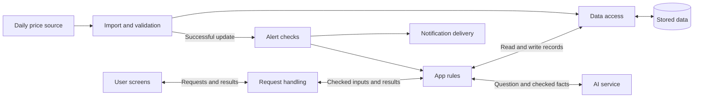

# Architecture Options

Status: Proposed design. Framework, database, and hosting choices remain open.

The [project scope](project-scope.md) defines feature decisions. This document explains how the parts could work together. Record names and interfaces below are proposals, not a completed database or API design.

## 1. Proposed structure

Start with one app service and one database. Keep the parts below separate in the code so they can be understood and checked on their own.

| Part | Owns | Boundary |
|---|---|---|
| User screens | Search, chat, lists, budgets, settings, and offline display | Show returned facts and errors; do not invent missing values |
| Request handling | Read requests, identify the user, check input format, return results | Keep price and alert rules in the app-rule part |
| App rules | Matching, comparison, totals, tracking, reminders, and access decisions | Use fixed calculations; check access to personal and shared records |
| Data access | Read and write records safely | Keep price-ranking and recommendation rules outside storage code |
| Import and validation | Retrieve source files, check rows, record source details | Make only accepted data available to comparisons |
| AI connection | Interpret questions and explain checked results | Use allowed app operations; source text is data, not an instruction |
| Alert checks and delivery | Apply targets, quiet hours, snooze, and delivery rules | Record events and delivery results to prevent repeated messages |

These are code responsibilities, not seven separate hosted services. “Request handling”, “app rules”, and “data access” are often called controller, service, and repository layers.

## 2. A price question

1. The user asks a question, such as “Where is this 5 kg rice pack cheapest?”
2. The app finds matching products. If the product is unclear, it asks the user to select one.
3. The app reads valid retailer listings for the selected product and pack.
4. Fixed app rules calculate the lowest listed price and identify ties or missing records.
5. The AI explains those results. The screen renders the checked amounts, product, and retailer.
6. If the AI service fails or gives an unsupported answer, show the checked comparison with a clear message.

Search and comparison must work without a successful AI call. The AI must not choose a different pack to make a result look cheaper. Past-purchase defaults require purchase records; saved items alone are insufficient.

This flow supports R01–R02, R15, and R18. Conditional matching under R04 still needs defined rules.

## 3. A daily price update

1. Retrieve the source file and record its retrieval time and source date, if available.
2. Check the file format, required fields, prices, product keys, and duplicate or conflicting rows.
3. Prepare accepted records separately from the data users currently see. Define when to reject a file or set aside individual rows.
4. Save accepted records and make the new version available only after the required checks succeed.
5. Run target-price and price-drop checks for tracked items. Apply quiet hours and snooze settings.
6. Record each alert event and delivery result. Retrying an import or delivery must not create repeated alerts unintentionally.

Keep the last valid data if retrieval or validation fails. Re-reading the same unchanged file must not create duplicate price history. Retrieval time is not automatically the date the retailer observed a price.

R21 can check a target from one current price. A drop needs an earlier comparison record. History retention and the selected comparison date remain open decisions.

## 4. Main records and their links

| Record | Main contents | Links and purpose |
|---|---|---|
| Product | Source product code, brand, names, category, checked pack details | One product can have listings at several retailers; keep language labels attached to the same checked identity |
| Retailer | Source code and display name | Identifies a company, not a branch |
| Import record | Source, retrieval time, source date if known, validation result, source-version identity | Connects prices to the file they came from |
| Price record | Product, retailer, amount, original offer text, observation/source date when available | References an import; a current listing is the selected latest valid record |
| User | User identity and settings | Owns private choices and may have access to shared lists |
| Tracked item | User, product, retailer choice if supported, tracking dates, alert settings | Connects one user's choices to shared price records |
| Shopping list and list item | List, product, quantity, item state | Members have defined access; shared edits need an agreed conflict rule |
| Budget and purchase entry | Budget period/amount; actual product, quantity, amount paid, and date when recorded | Keep estimated list totals separate from actual spending |
| Reminder | User/item, interval or use-rate input, next date, snooze state | Supports clear, snooze, and add-to-list actions |
| Alert event | Tracked item, triggering price record, rule, event time, delivery state | Supports repeat prevention and delivery checks |

These describe logical records; they do not require one database table each. Wishlist and tracked-item records may share a design only after the team agrees what each action means.

Public price records can be shared across users. Tracking choices and personal records stay separate. The ! mark limits feature behaviour; it does not require separate copies of public prices for every user.

A shared list needs explicit membership and edit rights. Deleting a user's personal data must follow an agreed rule for records also used by other list members.

## 5. Inputs and outputs to agree

Use these boundaries to make the parts fit together. Exact field names and web routes can be chosen later.

| Operation | Input | Output |
|---|---|---|
| Search products | Query, language, optional filters | Candidate products with enough pack detail to select correctly |
| Compare a product | Selected product/pack and retailer filter | Listed prices, ties, unavailable records, and source details |
| Add tracking | User, selected product, tracking choices | Saved tracking state or a clear input error |
| Total a shopping list | List, quantities, comparison rule | Total or incomplete total, missing items, and retailers used |
| Explain a result | Question and checked comparison facts | Explanation tied to those facts, or an explicit failure |
| Apply a shared-list change | User, list/item, requested change, prior state/version | Accepted state or a conflict the app can resolve visibly |

Do not let each part invent its own meaning of product identity, money, dates, or missing values. Use the [shared terms](product-description.md#shared-terms) and scope rules.

## 6. Shared lists and offline use

Shared lists require a way to identify users and control access. A browser-only list can demonstrate screens, but does not complete R32.

Offline viewing can use previously saved prices and lists with their age shown. Offline editing needs stored pending changes and a rule for combining them with later server changes. The team must decide whether that extra behaviour is included in R48.

Daily imports, external notifications, and remote AI calls need a network connection. A device being offline must not be shown as a successful remote update.

## 7. Build options and trade-offs

| Option from the earlier proposal | Potential benefit | Main cost or question |
|---|---|---|
| Java with Spring Boot | Existing components can cover common web and data-access tasks | Team members need to understand configuration and test the resulting behaviour |
| Java with embedded Jetty and selected libraries | More direct control over how requests reach app code | The team owns more request wiring, data mapping, access checks, and error handling |

Both options still need the same product rules and data checks. Neither makes AI answers, shared-list access, or price calculations correct automatically.

A decision should consider course rules, team knowledge, setup effort, and a small working example. Exact library versions and setup instructions need checking after the option is selected. There is no measured basis here for “minutes versus hours” or fixed completion costs.

PostgreSQL is a proposed database option. A separate cache such as Redis is optional; add it only for a clear need. The database and ordinary app code may be enough for the initial load.

## 8. Remaining design choices

Language/framework, database, hosting, user sign-in, notification channels, data retention, and offline editing remain open. Product-level questions are listed in the [feasibility review](feasibility-review-simple.md#5-open-decisions).

Choose behaviour before finalising storage or interfaces. For example, allowing offline edits changes the shared-list design; showing actual spending requires purchase entries.
